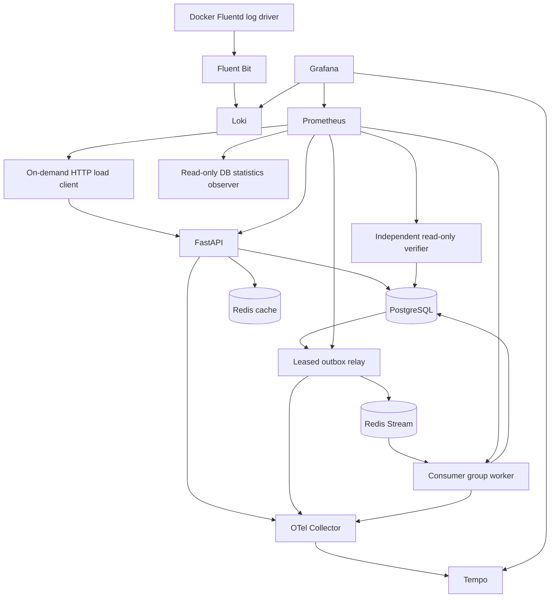

# PulsePay architecture

PulsePay is a synthetic transaction laboratory. Every unit is fake; no banking/payment/authentication integration exists.

API handlers validate/serialize; application services own transactions. PostgreSQL atomically commits balances, a transfer, two ledger entries and an outbox row. The HTTP result does not wait for event projection. Redis is never consulted to approve money movement. Cache invalidation happens after commit and can fail independently.

The relay leases up to 25 pending rows using `FOR UPDATE SKIP LOCKED`, commits the claim, publishes outside the DB transaction, then marks the row published. Expired 30-second leases recover interrupted claims. Publication may repeat after a crash; the consumer uses the stable event ID. Receipts and a notification projection commit together before XACK. XAUTOCLAIM reclaims deliveries idle for 10 seconds. A fresh group starts at stream ID 0, preserving existing events. Invalid messages are durably quarantined with original evidence before acknowledgement.

PostgreSQL, Redis, workers and telemetry backends use the internal network. API, Grafana, Prometheus and the log collector also use an edge network for loopback-only published ports. Docker 29 does not publish ports for an internal-only network in the tested Desktop environment. No application container mounts the Docker socket, runs privileged, or joins host namespaces.

Runtime app/worker/verifier credentials differ from migration and owner credentials. The load container uses HTTP for all financial operations and SELECT-only credentials for independent verification. The verifier has independent SQL and no imports of application models/services. Shared configuration, metrics and process hosting do not supply business logic.

Redis uses AOF with `appendfsync always` and `noeviction`: confirmed writes must be durable for the local transport guarantee; memory pressure rejects writes instead of silently evicting stream state. Stream transport remains at-least-once, with exactly-once logical projection effects. PostgreSQL evidence remains available after transport interruption.

Design references: [PostgreSQL row lock ordering](https://www.postgresql.org/docs/17/explicit-locking.html), [Redis XAUTOCLAIM](https://redis.io/docs/latest/commands/xautoclaim/), [Docker Fluentd logging driver](https://docs.docker.com/engine/logging/drivers/fluentd/), [Fluent Bit Loki output](https://docs.fluentbit.io/manual/data-pipeline/outputs/loki/).

## Future contracts (definitions only)

Observation snapshot v1 is represented by `shared.contracts.ObservationSnapshot`: version, UTC observation time, window seconds, system, health, signals, freshness, and missing signal names. The illustration in the supplied spec is not a measurement. Missing/stale signals must remain UNKNOWN; do not infer health from an empty vector. Independent experiment IDs will live outside financial IDs. No hidden fault truth belongs in decision inputs.

Locust uses public APIs and remains independent of financial services. Chaos Workbench is a separate local UI in the same Compose project, delegating only reviewed native CLI actions. Framework experiments use Chaos Toolkit YAML, pinned Pumba helpers and an optional dependency-routing Toxiproxy overlay. A separate default-deny Docker gate authorizes frozen lab targets; an independent watchdog restores them. Only this private gate mounts the host socket. No custom chaos engine, decision/action loop, Laya or autonomous remediation is implemented. See [framework boundaries](phase3-operations.md).

Future model-facing action envelopes remain documentation only: bounded permitted choices, preconditions, expiry and authorization scope. Existing framework actions are reviewed native experiment definitions with independently enforced safety bounds. Privileged experiment truth stays separate from the [sanitized observation contract](observation-contract.md); consumer permissions and decision-making are future work.
# Operator dashboard

The existing FastAPI service serves `/` and same-origin `/ui/*` assets. The browser consumes bounded read-only dashboard APIs and uses the original transactional write APIs for account creation and transfers. Independent verifier reports remain a separate process, fetched through fixed server-side URLs with deadlines and freshness validation. See [dashboard boundaries](dashboard.md).
