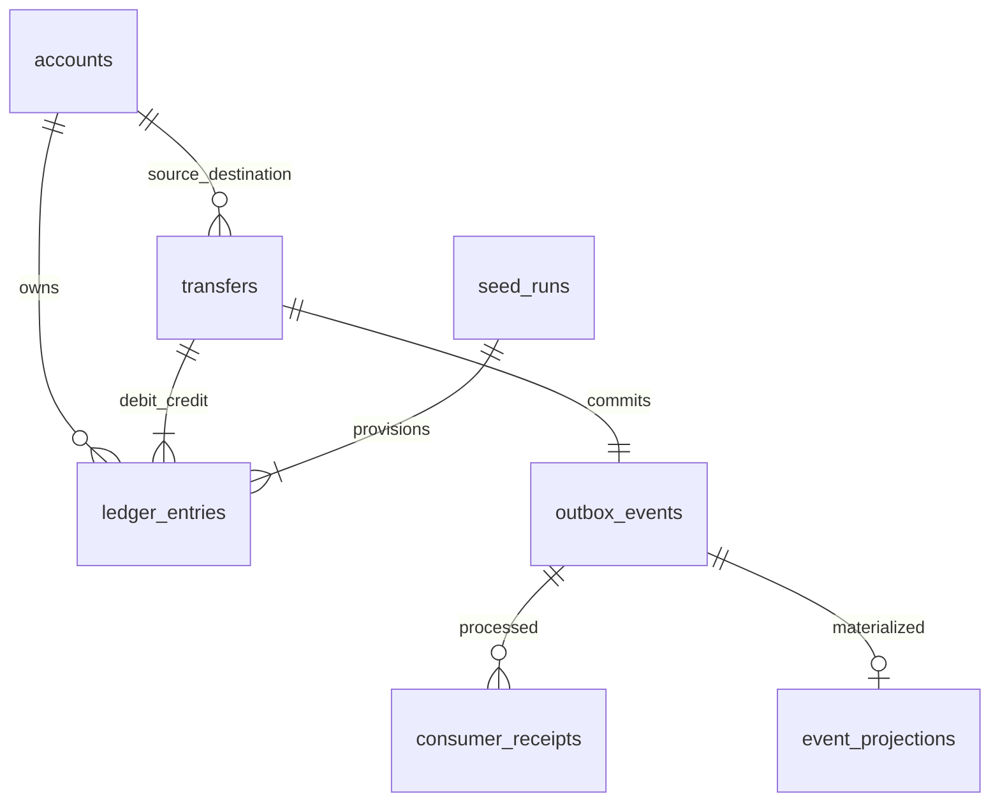

# Data model and transaction protocol

Money is signed/unsigned integer minor units backed by PostgreSQL BIGINT. Balances cannot be negative; transfers require positive amounts and distinct accounts. Currency is an uppercase three-letter code; this lab supports one configured currency. Application validation rejects booleans, floats and bigint overflow.

Tables: `accounts`, successful `transfers`, append-only `ledger_entries`, transactional `outbox_events`, `consumer_receipts`, unique `event_projections`, explicit `seed_runs`, durable `event_quarantine`, and timestamped `service_heartbeats`. Migration 0002 defines constraints/indexes/privileges; Alembic 0001 initializes migration visibility. Migrations are forward-only to protect financial history.

Ledger entry kinds are debit, credit and explicit provisioning. Transfer rows have exactly one debit and credit enforced by the service and independently checked by SQL; partial unique indexes prohibit duplicate transfer kinds. Provisioning references a seed run; `(seed_run_id, account_id)` is unique. Triggers prohibit ledger UPDATE/DELETE even for table owners unless deliberately disabled by elevated throwaway tests. Runtime roles cannot update/delete ledger, transfer, seed or event payload records.

Transfer protocol:

1. Canonicalize the typed request (sorted compact JSON) and SHA-256 it. Check the unique idempotency key.
2. Within one transaction lock both account rows in ascending UUID order. Re-read idempotency after waiting for locks.
3. Recheck active status, currencies, funds, and destination bigint capacity.
4. Insert transfer, mutate balances, insert equal/opposite ledger entries, and insert `TransferCommitted` outbox envelope.
5. Commit once before returning 201. Replays return 200 and the original ID; payload conflicts return 409.

Concurrent same-key insertion on disjoint pairs resolves via the database uniqueness constraint. A losing transaction rolls back completely, then reads the committed winner in a fresh transaction. SQLSTATE 40P01/40001 retries the whole transaction at most three attempts, with bounded exponential jitter. Connection/statement/lock/pool timeouts are bounded; an ambiguous HTTP timeout must be retried with the same key and payload.

Seed IDs are public deterministic UUIDv5 values of `pulsepay:<seed_version>:<index>` in `NAMESPACE_URL`. Default run `phase1-v1` creates 200 accounts with 100,000 minor units each. The whole run, accounts, balances and provisioning entries commit atomically under a seed-version advisory lock. Repetition returns the same manifest; changed configuration with an existing version fails. No public account-create route issues money.

Roles: app can SELECT operational/business tables, INSERT accounts/transfers/ledger/seed/outbox, and update account balance/status/timestamp. Worker can SELECT needed event evidence, update only relay state columns, and insert receipts/projections/quarantine/heartbeats. Verifier has SELECT only. Migrator owns schema/tables but is not a runtime credential. Owner is confined to initialization and isolated-test database administration.
