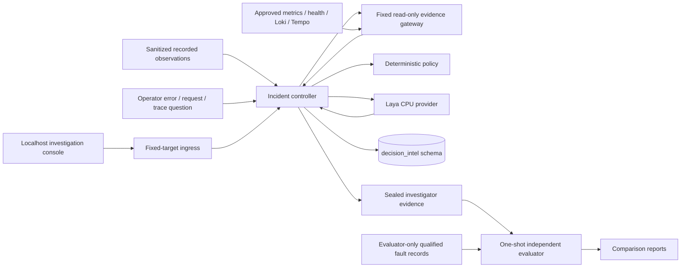

# PulsePay decision intelligence

Current permitted modes are **offline shadow** and **operator-requested live suggestions**. The independent readiness audit grants shadow GO and withholds autonomous read-only GO. Manual questions collect fixed read-only observations chosen by the operator; they do not authorize model-selected diagnostics, Docker/chaos controls, workload changes or financial mutations.

`incident-controller` mounts only `public-observations`, never the baseline parent or native chaos journals. Its model state includes whitelisted typed symptoms, recorded timestamps, quality flags and provenance. Opaque dataset/session IDs are omitted from inference. Free-text logs, paths, injector metadata, source run identifiers and fault titles are excluded. Canary tests exercise requests, rejected answers, API history and exported records.

`laya-service` has no DB credentials, evidence, telemetry or Docker access. Its sole internal network is `decision-model`. Runtime cache is read-only. Laya 0.4.3 verifies hardcoded SHA-256 values for the pinned weights, model/encoder configuration and tokenizer before loading. Normal restarts are offline. Explicit `model-provision` alone has download access and a writable cache.

The controller uses restricted store, model, public-observation and UI networks plus `decision-observations`. It cannot reach raw Prometheus, Loki, Tempo or privileged chaos controls. The isolated, secret-free `evidence-reader` bridges the observations network to fixed bounded GET-only telemetry sources. It discards raw strings, IDs, SQL and privileged metadata; the model cannot reach the gateway. `investigation-ui` bridges localhost ingress to the dedicated UI network; it has no credentials, mounts, model network or DB network. It forwards bounded GET/POST requests only to the fixed controller address. Docker Desktop did not publish a port for the all-internal controller; ingress corrects this without adding external connectivity to the controller.

Evaluator labels and the split design exist only in the trusted tools image. `decision-evaluator` mounts qualified native runs separately and uses `pulsepay_evaluator`, which the model/controller do not receive. Evaluations are absent from model requests, investigator bundles and investigator APIs. Operator artifacts are local files; do not expose their parent directory as an investigator HTTP route.

Persistence uses separate Alembic `decision_intel.schema_version=di0002`; the financial `public.alembic_version=0002` remains unchanged. The additive second revision permits the `live_question` session mode. `pulsepay_decision` can append decision history and update session terminal state; it cannot read or mutate core financial tables, access `decision_evaluation`, delete history or perform DDL. The migrator is a one-shot role. Evaluator tables reside in `decision_evaluation` with separate privileges.

Frozen replay questions are `investigation-v1`: subsystem choice, severity expected ordinal score, evidence-insufficiency P(true), and dynamic choice among eight fixed read-only tool IDs. Manual questions add a possible-reason choice in `first-response-v1`. Their `live-input-v1` projection places call evidence first and retains compact source quality and measurements; full observations remain in history. The pinned SDK must report zero dropped state tokens and no truncated questions. Missing or incomplete usage is rejected. Actual inference-input hashes are validated by the controller and again when reconstructing sealed exports. Nested source maps are canonicalized to survive JSONB key reordering. A severity score is never rounded into a claimed category. Distributions must be finite, bounded and normalized. Invalid/provider/unavailable answers escalate safely. Suitability rankings are uncalibrated model scores; evidence yield is unknown without actual diagnostics.

Policy is frozen `shadow-policy-v1`. Two consecutive observed impairment windows trigger a replay incident. The causal planner consumes historical frames in order and starts the decision budget at the first observed trigger; no future frame selects an earlier action. A recording without a trigger may be manually replayed as a control, but cannot count as a localized incident. Critical missingness/staleness, failed integrity, budgets and repeat-action rules override recommendations. Every shadow decision has `execute=false`; registry execution always raises `PermissionError`.

Defaults: eight decisions, six reserved diagnostic calls, two concurrent sessions, 180-second session deadline, 15-second inference timeout and 10-second future diagnostic timeout. HTTP bodies are capped at 16 KiB, dataset captures at 4 MiB/512 frames, PostgreSQL pool at two, query timeouts at five seconds and ingress responses at 1 MiB. Repeated cancellation shares one finalization task and cannot interrupt sealing. Controller restart escalates interrupted sessions and retains partial evidence instead of resuming unapproved work.

A timed-out SDK CPU thread cannot start a second inference thread. Readiness becomes unavailable once the 15-second budget expires while work remains outstanding. Python cannot safely terminate that thread; the operator must restart the model container if it remains stuck. Hard worker-process termination is deferred and is an explicit shadow limitation. CPU/memory/process ceilings still apply.

Independent framework restoration and financial verification own recovery. Ending a shadow session never sets recovery to PASS. The controller does not implement a live polling incident detector or autonomous executor in this restricted release.
